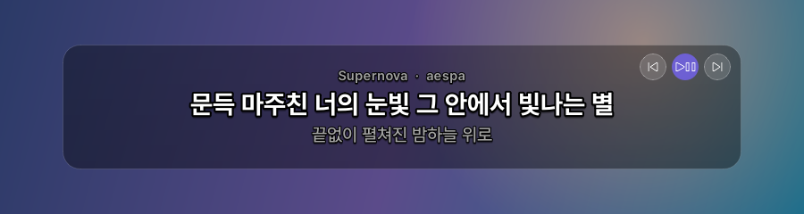
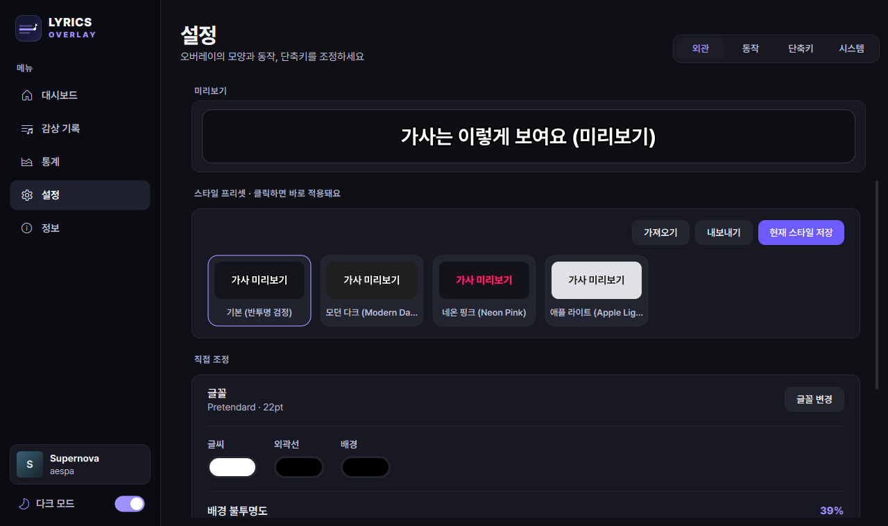
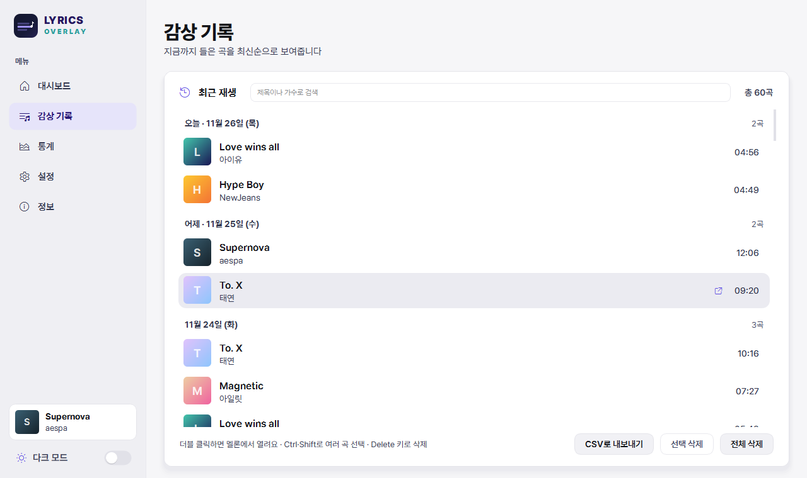
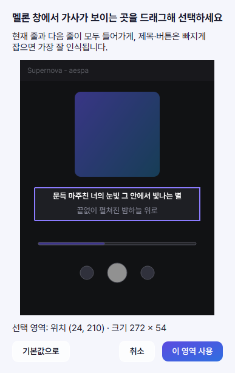
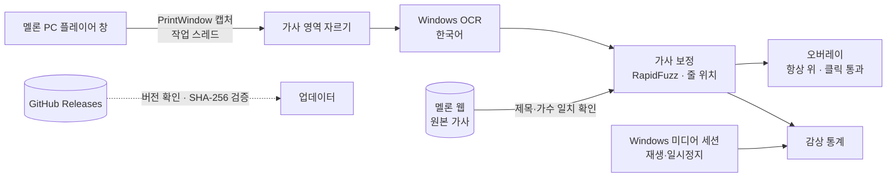

<div align="center">

# 🎵 LyricsOverlay

**멜론에서 듣는 노래의 가사를, 지금 쓰고 있는 화면 위에 띄워 둡니다.**

게임이나 작업 중에도 멜론 창을 열지 않고 가사를 따라갈 수 있는 Windows용 가사 오버레이입니다.

[](https://github.com/Ow-wL/LyricsOverlay/actions/workflows/tests.yml) [](https://github.com/Ow-wL/LyricsOverlay/releases/latest)    



</div>

> [!IMPORTANT]
> **멜론과 연동되는 공식 프로그램이 아닙니다.** 멜론 창에 보이는 가사를 화면 캡처와 Windows OCR로 읽고, 멜론 웹의 원본 가사와 비교해 오타를 바로잡는 방식입니다. 그래서 멜론 창에 가사가 표시되어 있어야 하고, 멜론 화면이나 웹 페이지 구조가 바뀌면 인식이나 보정이 동작하지 않을 수 있습니다. 가사는 화면에 표시할 때만 조회하며 파일로 저장하지 않습니다. 멜론 웹 조회는 **설정 → 시스템 → 멜론 연동**에서 끌 수 있습니다.

## 목차

[화면](#-화면) · [주요 기능](#-주요-기능) · [동작 방식](#%EF%B8%8F-동작-방식) · [설치](#-설치) · [사용 순서](#-사용-순서) · [단축키](#%EF%B8%8F-단축키) · [데이터와 개인정보](#-데이터와-개인정보) · [소스에서 실행·빌드](#%EF%B8%8F-소스에서-실행빌드) · [확인한 환경](#-확인한-환경) · [알려진 제한](#%EF%B8%8F-알려진-제한) · [문서](#-문서)

## 📸 화면

<table>
  <tr>
    <td width="50%" align="center"><br><sub><b>대시보드</b> — 감상 요약, 인식 상태, 오버레이 빠른 제어</sub></td>
    <td width="50%" align="center"><br><sub><b>외관 설정 (다크)</b> — 값을 바꾸면 위쪽 미리보기에 바로 반영</sub></td>
  </tr>
  <tr>
    <td width="50%" align="center"><br><sub><b>감상 기록</b> — 검색 · 선택 삭제 · CSV 내보내기</sub></td>
    <td width="50%" align="center"><br><sub><b>가사 인식 영역 지정</b> — 화면 배율이 달라도 직접 맞춤</sub></td>
  </tr>
</table>

<sub>예시 데이터로 만든 화면입니다. 가사 문장과 플레이어 그림은 설명용으로 지어낸 것입니다. 화면은 `docs/guide/make_screenshots.py`로 다시 만들 수 있습니다.</sub>

## ✨ 주요 기능

| | 기능 | 내용 |
|---|---|---|
| 🎤 | **실시간 가사 표시** | 현재 줄과 다음 줄, 곡 제목과 가수를 항상 위에 뜨는 반투명 창으로 보여 줍니다. 가사가 길면 창 크기는 그대로 두고 글자를 줄입니다 |
| 🔤 | **OCR 오타 보정** | 멜론 웹에서 같은 곡(제목·가수가 맞는 결과만)의 원본 가사를 받아, OCR 결과를 가장 가까운 줄로 바로잡습니다. 후렴처럼 비슷한 줄은 지금 위치에 가까운 줄을 고릅니다 |
| 👻 | **클릭 통과 (고스트 모드)** | 오버레이 위를 클릭해도 뒤의 창이 눌립니다. 멜론 창을 투명하게 숨길지 따로 정할 수 있어 듀얼 모니터에서도 씁니다 |
| 📐 | **위치·크기 조정 모드** | 버튼 하나로 들어가 끌어서 옮기고 모서리로 크기를 바꾼 뒤 완료(Enter)·취소(Esc). 화면 밖으로 나간 오버레이는 시작할 때 되돌려 놓습니다 |
| 🎯 | **가사 인식 영역 지정** | 멜론 창 캡처 위에서 가사 영역을 드래그로 고릅니다. Windows 화면 배율 125%·150% 환경 대응 |
| 🩺 | **인식 상태 안내** | 멜론 없음·최소화·영역 이탈·글자 미검출·OCR 미설치를 대시보드에 표시하고, 고칠 수 있는 버튼을 붙입니다 |
| ⏯️ | **재생 제어** | 대시보드와 오버레이의 이전 곡·재생/일시정지·다음 곡 버튼, 전역 단축키 |
| 📊 | **감상 기록과 통계** | 일별·주별·월별 그래프, 자주 들은 노래·가수 순위. 감상 시간은 멜론이 실제로 재생 중일 때만 셉니다 |
| 🗂️ | **기록 관리** | 검색, 여러 곡 선택 삭제, 전체 삭제, CSV 내보내기, 기록 저장 끄기 |
| 🎨 | **오버레이 꾸미기** | 글꼴, 글씨·외곽선·배경 색, 불투명도, 크기. 프리셋 저장·가져오기·내보내기 |
| 🔄 | **새 버전 알림·업데이트** | GitHub 릴리스를 하루 한 번 확인하고, 받은 파일을 SHA-256으로 검증한 뒤 교체·재시작합니다 |
| 🧭 | **편의** | 트레이 최소화, 중복 실행 방지, 첫 실행 3단계 안내, 라이트·다크 테마, 창 크기 조절, 키보드 조작 |
| 🧰 | **문제 대비** | 트레이의 **멜론 창 되돌리기**, 원인을 찾기 위한 진단 로그(가사는 남기지 않음), 멜론 요청이 거절되거나 계속 실패하면 스스로 멈춤 |

## ⚙️ 동작 방식



- **멜론 창은 가려져 있어도 읽습니다.** `PrintWindow`로 창 내용을 직접 캡처하므로 다른 창 뒤에 있어도 되고, 최소화만 하지 않으면 됩니다. 캡처는 작업 스레드에서 해서 멜론이 응답하지 않아도 화면이 멈추지 않습니다.
- **엉뚱한 가사로 바꾸지 않습니다.** 멜론 검색 결과 중 제목·가수가 맞는 곡이 없으면 보정하지 않고 OCR 결과를 그대로 씁니다.
- **멜론 창은 항상 원래대로 돌아옵니다.** 창 상태를 바꾸기 전에 원래 값을 파일에 적어 두고, 종료할 때나 비정상 종료 뒤 다음 실행 때 복구합니다. 멜론 프로세스가 아닌 창은 건드리지 않습니다.
- **재생 상태는 Windows 미디어 세션에서 읽습니다.** 일시정지 중에는 감상 시간을 세지 않고, 같은 곡을 처음부터 다시 틀면 새 재생으로 기록합니다.
- **업데이트는 원래 실행 파일을 끝까지 남겨 둡니다.** 새 파일을 받아 검증한 뒤, 기존 프로그램이 완전히 끝난 것을 확인하고 한 번에 교체합니다. 교체에 실패하면 원래 버전을 다시 실행합니다.

## 📥 설치

1. [최신 릴리스](https://github.com/Ow-wL/LyricsOverlay/releases/latest)에서 `LyricsOverlay.exe`를 내려받아 쓰기 권한이 있는 폴더(바탕 화면, `문서` 등)에 둡니다. 설치 과정은 없습니다.
2. 실행합니다. "Windows의 PC 보호" 창이 뜨면 **추가 정보 → 실행**을 누릅니다. 코드 서명이 없는 개인 제작 프로그램이라 표시되는 안내입니다.
3. 받은 파일이 바뀌지 않았는지 확인하려면 릴리스의 `LyricsOverlay.exe.sha256.txt`와 비교합니다.

```powershell
Get-FileHash .\LyricsOverlay.exe -Algorithm SHA256
```

**필요한 것:** Windows 10 이상 · 멜론 PC 플레이어 · Windows 한국어 OCR(설정 → 시간 및 언어 → 언어 및 지역 → 한국어 → 언어 옵션)

1.2.0부터는 새 버전이 나오면 앱에서 바로 업데이트할 수 있습니다. 1.1.0을 쓰고 있다면 이번 한 번은 릴리스에서 직접 받아 교체해 주세요.

## 🚀 사용 순서

1. 멜론에서 노래를 틀고, 가사가 보이는 상태로 창을 둡니다.
2. LyricsOverlay를 실행합니다. 처음에는 대시보드에 세 단계 안내가 나오고, 단계를 마칠 때마다 체크됩니다.
3. 가사가 오버레이에 나오지 않으면 **영역 지정**으로 멜론 창에서 가사가 보이는 곳을 고릅니다.
4. **위치·크기 조정**으로 오버레이를 원하는 곳에 두고 **완료**를 누릅니다.
5. 창의 X를 누르면 트레이로 숨고 오버레이는 계속 동작합니다. 완전히 끄려면 트레이 메뉴의 **종료**를 누릅니다.

자세한 사용법은 릴리스에 첨부된 **사용 가이드**(`LyricsOverlay_Guide_v<버전>.pdf` · `.html`)에 있습니다.

## ⌨️ 단축키

| 동작 | 기본값 |
|---|---|
| 고스트 모드 켜기/끄기 | `F9` |
| 재생 / 일시정지 | `F8` |
| 다음 곡 | `Ctrl` + `Shift` + `→` |
| 이전 곡 | `Ctrl` + `Shift` + `←` |
| 프로그램 종료 | `Ctrl` + `Alt` + `Q` |

**설정 → 단축키**에서 바꿉니다. 다른 프로그램에서 타이핑할 때도 동작하는 전역 단축키라 `Q`, `Shift+Q`처럼 글자 하나로 된 조합과 다른 기능과 겹치는 조합은 받지 않습니다. 재생 관련 단축키와 버튼은 멜론 창에 직접 명령을 보내므로 다른 앱은 반응하지 않습니다. 단축키는 Windows 표준 방식(RegisterHotKey)으로 등록해 키보드 전체를 지켜보지 않고, 누르고 있어도 한 번만 실행됩니다. 등록한 조합은 앱이 켜져 있는 동안 다른 프로그램에서 동작하지 않습니다.

## 🔒 데이터와 개인정보

| 무엇을 | 어디에 | 비고 |
|---|---|---|
| 감상 기록, 누적 통계 | `문서\LyricsOverlay\lyrics_stats.json` | 평문 JSON. **설정 → 시스템**에서 기록 저장을 끄거나, **감상 기록**에서 지우고 내보낼 수 있습니다 |
| 오버레이·단축키 설정, 가사 인식 영역 | `overlay_settings.json` | |
| 스타일 프리셋 | `overlay_styles.json` | |
| 앨범 커버 | `covers\` (곡 ID별 jpg, `index.json`) | **설정 → 시스템 → 받은 커버 지우기** |
| 데이터 폴더 위치, 기록 저장·멜론 연동·커버 자동 채우기·진단 로그·자동 업데이트 확인 여부, 앱 글꼴, 멜론 요청을 쉬는 중인 시각 | Windows 레지스트리 (`HKCU\Software\Ow-wL\LyricsOverlay`) | |
| 진단 로그, 멜론 창 복구 기록 | `%LOCALAPPDATA%\LyricsOverlay\` (`LyricsOverlay.log`, `window_restore.json`) | 로그에는 곡 제목·가수와 오류가 들어가고 가사는 들어가지 않습니다. 최대 약 1.5MB. **정보 → 진단 로그 남기기**로 끄면 남은 로그도 지우며, 기록 저장을 끄면 함께 멈춥니다 |

감상 기록 파일은 PC 밖으로 보내지 않습니다. 밖으로 나가는 요청은 아래와 같습니다.

| 요청 | 보내는 정보 | 끄는 방법 |
|---|---|---|
| 멜론 웹 가사 검색 (`www.melon.com`) | 재생 중인 곡 제목과 가수 | **설정 → 시스템 → 멜론에서 가사 원문 가져오기** (끄면 OCR 결과만 표시) |
| 앨범 커버 (`cdnimg.melon.co.kr`) | 커버 이미지 주소 | **설정 → 시스템 → 앨범 커버 받기** |
| 예전 기록 커버 채우기 (`www.melon.com`) | 커버가 없는 예전 곡의 제목과 가수 | 버튼을 눌렀을 때(한 번에 20곡, 10분 간격) 또는 **조금씩 자동으로 채우기**를 켰을 때(듣는 동안 5분에 한 곡, 기본 꺼짐) |
| 새 버전 확인 (`api.github.com`) | IP 주소, `LyricsOverlay/<버전>` User-Agent | **정보 → 새 버전 자동 확인** |

멜론으로 가는 요청은 `LyricsOverlay/<버전>` User-Agent로 앱 이름을 밝히고, 요청 사이에 1초 이상 간격을 둡니다. 멜론이 거절하면 30분, 10분 안에 세 번 실패하면 10분 동안 보내지 않고, 이 시간은 앱을 다시 켜도 이어집니다. 한 번 들은 곡은 검색을 건너뛰어 곡 페이지만 요청하고(받은 페이지의 제목·가수가 맞을 때만 씀), 같은 실행 중에 다시 듣는 곡은 요청하지 않습니다(가사는 메모리에만 두고 파일로 저장하지 않습니다).

문서 폴더가 OneDrive로 백업되고 있다면 감상 기록도 클라우드에 동기화될 수 있습니다. 원하지 않으면 **설정 → 시스템 → 경로 변경**으로 OneDrive 밖으로 옮기세요.

## 🛠️ 소스에서 실행·빌드

**필요한 것:** Python 3.10 이상 (빌드는 3.10 가상환경 기준)

```powershell
python -m venv venv
```
```powershell
.\venv\Scripts\python.exe -m pip install -r requirements.txt
```
```powershell
.\venv\Scripts\python.exe main.py
```

실행 파일 빌드는 `build.ps1` 하나로 합니다. `main.spec`으로 빌드하고, 인증서 지문(`LYRICSOVERLAY_SIGN_THUMBPRINT`)이 설정되어 있으면 서명한 뒤, `dist\LyricsOverlay.exe.sha256.txt`에 체크섬을 남깁니다.

```powershell
.\venv\Scripts\python.exe -m pip install -r requirements-build.txt
```
```powershell
.\build.ps1
```

<details>
<summary><b>새 버전 배포 순서</b></summary>

1. `core/version.py`의 `APP_VERSION`을 올려 `main`에 머지합니다.
2. 그 커밋에 버전 숫자 태그(예: `1.4.0`)를 만들어 올립니다. `release` 워크플로가 테스트, exe 빌드와 자체 점검, 사용 가이드 생성을 한 뒤 파일 5개를 첨부한 릴리스 **초안**을 만듭니다. 태그와 `APP_VERSION`이 다르면 멈춥니다.
3. 초안의 exe를 받아 직접 실행해 확인하고, 변경 내용을 적은 뒤 게시합니다. 초안과 사전 릴리스는 업데이트 알림에 잡히지 않습니다.

손으로 할 때는 `.\build.ps1`과 `venv\Scripts\python.exe docs\guide\build_guide.py`를 실행하고, `dist`의 `LyricsOverlay.exe`(이름 그대로)·`.sha256.txt`·가이드 PDF·HTML·`THIRD_PARTY_NOTICES.txt`를 첨부합니다.

앱은 릴리스 자산에 대해 GitHub가 계산한 SHA-256(`digest`)과 받은 파일을 비교한 뒤에만 교체합니다. 자세한 내용은 [INSTALL.md](INSTALL.md)에 있습니다.

</details>

<details>
<summary><b>저장소 구성</b></summary>

```text
main.py              진입점, 메인 루프 (창 탐지 → 캡처 → OCR → 가사 보정 → 화면 갱신 → 통계)
core/
  window_capture.py  멜론 창 찾기, PrintWindow 캡처, 창 스타일 변경·복구
  ocr_engine.py      Windows OCR (한국어 우선)
  media_session.py   Windows 미디어 세션에서 재생 상태 읽기
  hotkey_manager.py  전역 단축키, 미디어 키 전송
  stats_manager.py   감상 기록 저장·검증
  melon_http.py      멜론 요청 간격, 거절·연속 실패 시 멈춤
  covers.py          앨범 커버 받기·저장, 예전 기록 채우기
  app_log.py         진단 로그 파일
  app_config.py      데이터 폴더, 앱 설정 (QSettings)
  single_instance.py 중복 실행 방지
  updater.py         새 버전 확인 (GitHub Releases)
  update_install.py  업데이트 내려받기·검증·교체
lyrics/
  searcher.py        멜론 웹 가사 검색 (작업 스레드, 결과 검증)
  matcher.py         OCR 결과와 원본 가사 매칭 (줄 위치 고려)
overlay/             가사 오버레이 창, 외곽선 글자, 오버레이 설정
gui/
  main_window.py     메인 창, 트레이, 업데이트·기록 관리 연결
  pages/             대시보드, 감상 기록, 통계, 설정, 정보
  widgets/           유리 카드, 토글 스위치, 재생 버튼, 단축키 입력, 막대 그래프
  roi_selector.py    가사 인식 영역 지정 창
  update_dialog.py   업데이트 창
docs/guide/          사용 가이드 원본과 스크린샷·빌드 스크립트
tools/make_icon.py   여러 크기 아이콘 생성
asset/               아이콘, 앱 글꼴(Pretendard·나눔스퀘어 네오·Wanted Sans), README 스크린샷
```

</details>

## ✅ 확인한 환경

화면·네트워크 없이 확인할 수 있는 핵심 로직은 단위 테스트(`tests/`)로 고정해 두었고, push와 PR마다 GitHub Actions(Windows, Python 3.10)에서 실행합니다.

```powershell
.\venv\Scripts\python.exe -m unittest discover -s tests -t .
```

| 테스트 | 지키는 것 |
|---|---|
| `test_lyrics.py` | 검색 결과에서 제목·가수가 맞는 곡만 고르기, OCR 오타 보정, 비슷한 줄은 지금 위치에 가까운 줄 선택 |
| `test_updater.py` | 버전 비교, 사전 릴리스·검증값 없음·중복 자산·다른 저장소 주소 거부, 허용 밖 호스트 차단, 다른 파일 교체 거부 |
| `test_data.py` | 손상된 설정·통계 파일 처리, 데이터 경로 변경 확인·백업, 반복 재생·일시정지 판정, 단축키 규칙 |
| `test_window_guard.py` | 멜론 창 숨기기·복구: 강제 종료 뒤 복구, 남은 투명 창 되돌리기, 멜론이 아닌 창은 건드리지 않기 (실제 Win32 창 사용) |
| `test_covers.py` · `test_requests.py` | 커버 저장과 채우기 제한, 이미 아는 곡의 검색 생략, 연속 실패 시 멈춤과 재시작 뒤 유지, 진단 로그에 가사가 남지 않는지 |

화면과 멜론이 필요한 동작은 기능을 바꿀 때마다 실제 실행으로 확인했습니다.

| 확인한 것 | 방법 |
|---|---|
| 가사 인식·보정, 트레이, 종료 후 멜론 창 복구 | Windows 11에서 실행 중인 멜론으로 메인 루프 실행 |
| 일시정지 중 감상 시간이 늘지 않음 | 실제 일시정지 상태에서 실행 |
| 화면 배율 | `QT_SCALE_FACTOR` 1.25 · 1.5로 모든 페이지 렌더링 |
| 키보드 조작 | Tab 이동(대시보드 18곳), Space로 메뉴·스위치 조작 |
| 멜론이 응답하지 않을 때 | 캡처를 5초씩 지연시켜 화면 정지 시간 측정 (5.06초 → 0.12초) |
| 업데이트 | 실제 릴리스 자산 내려받기와 SHA-256 대조, 빌드한 exe로 교체·재실행·정리 |

아직 확인하지 못한 환경은 Windows 10 실기기, 배율이 서로 다른 다중 모니터, 화면 낭독기입니다.

## ⚠️ 알려진 제한

- 멜론 창을 **최소화**하면 가사를 읽을 수 없습니다.
- 가사 보정은 멜론 웹 페이지 구조에 의존합니다. 구조가 바뀌면 OCR 결과가 그대로 표시됩니다.
- 재생 버튼과 미디어 단축키는 멜론 창에 직접 명령을 보냅니다. 멜론 창을 찾지 못하면 Windows 미디어 키로 대신 보내는데, 이때는 다른 앱이 반응할 수 있습니다.
- 관리자 권한으로 실행된 게임 안에서는 전역 단축키가 동작하지 않을 수 있습니다.
- 실행 파일에 코드 서명이 없어 처음 실행할 때 SmartScreen 경고가 뜹니다.

## 📚 문서

| 문서 | 내용 |
|---|---|
| [사용 가이드](https://github.com/Ow-wL/LyricsOverlay/releases/latest) | 릴리스 첨부 PDF·HTML. 처음 실행, 인식 영역, 오버레이, 기록, 업데이트, 문제 해결 |
| [INSTALL.md](INSTALL.md) | 소스 실행, exe 빌드, 새 버전 배포 |
| [docs/guide/README.md](docs/guide/README.md) | 사용 가이드와 스크린샷 다시 만들기 |

## 📝 고지

- 개인 학습과 포트폴리오 용도로 만든 비공식 도구이며, 멜론(카카오엔터테인먼트)과 제휴하지 않았습니다. 멜론(Melon)은 카카오엔터테인먼트의 상표입니다.
- 가사는 재생 중에 웹에서 조회해 화면에 표시하는 데만 쓰고, 데이터 파일에 가사 본문을 남기지 않습니다. 저장소의 스크린샷은 예시 가사와 대체 커버로 만든 것입니다.
- Lyrics Overlay는 [MIT 라이선스](LICENSE)로 공개합니다. 배포 exe에 포함된 Qt·PySide6(LGPL-3.0) 등 오픈소스 구성요소와 글꼴의 라이선스는 [THIRD_PARTY_NOTICES.txt](THIRD_PARTY_NOTICES.txt)에 있으며, 앱의 **정보 → 오픈소스 라이선스**에서도 열 수 있습니다.
- 내장 글꼴 Pretendard와 Wanted Sans는 SIL Open Font License 1.1([Pretendard](./asset/Font/OFL-Pretendard.txt), [Wanted Sans](./asset/Font/WantedSans/OFL-WantedSans.txt))을, 나눔스퀘어 네오는 NAVER의 [SIL Open Font License 1.1](./asset/Font/NanumSquareNeo/LICENSE-NanumSquareNeo.txt)을 따릅니다.

만든 사람: 이주형 ([@Ow-wL](https://github.com/Ow-wL)) · 문의와 버그 제보는 [Issues](https://github.com/Ow-wL/LyricsOverlay/issues)로 남겨 주세요.
