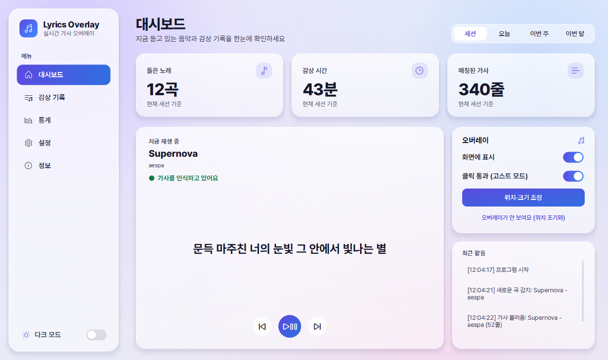

# 🎵 LyricsOverlay

**LyricsOverlay**는 멜론 PC 플레이어에서 재생 중인 가사를 실시간으로 읽어 와, 화면 위에 항상 떠 있는 투명 오버레이로 보여주는 Windows용 **가사 오버레이 도구**입니다.

Windows 기본 OCR로 멜론 창의 가사를 읽고, 웹에서 가져온 원본 가사와 비교해 오타를 바로잡습니다. 코딩, 게임, 웹 서핑 등 다른 작업을 하면서도 방해 없이 음악과 가사를 즐겨보세요.



---

## ✨ 주요 기능

- **실시간 가사 인식 및 자동 보정**  
  멜론 창의 가사 영역을 OCR로 읽고, 웹에서 가져온 전체 가사와 비교해 가장 비슷한 줄로 바로잡아 표시합니다. 가사 검색은 백그라운드에서 처리되어 곡이 바뀔 때도 화면이 멈추지 않습니다.

- **곡 정보 표시 & 긴 가사 자동 맞춤**  
  오버레이 상단에 지금 재생 중인 곡의 제목과 가수를 띄울 수 있습니다. 가사가 길면 오버레이 크기는 그대로 두고 글자 크기를 줄이거나 말줄임(…)으로 처리합니다.

- **재생 버튼 & 전역 단축키**  
  대시보드와 오버레이에서 이전 곡 · 재생/일시정지 · 다음 곡 버튼으로 바로 조작할 수 있습니다. 오버레이 버튼은 고스트 모드를 끈 상태에서 마우스를 올리면 나타납니다. 같은 동작을 단축키로도 쓸 수 있습니다.

- **고스트 모드 & 듀얼 모니터 지원**  
  고스트 모드에서는 오버레이가 마우스 클릭을 통과시켜 작업을 방해하지 않습니다. 기본적으로 멜론 창도 함께 투명하게 숨기며, 듀얼 모니터처럼 멜론 창과 오버레이를 같이 보고 싶다면 설정에서 **"고스트 모드에서 멜론 창 숨기기"**를 끄면 됩니다.

- **안전한 창 처리**  
  멜론 프로세스(`Melon Player.exe`)의 창만 대상으로 삼고, 바꿔 둔 창 상태는 종료할 때 원래대로 되돌립니다. 프로그램이 강제 종료되더라도 다음 실행 때 멜론 창을 자동으로 복구합니다.

- **글래스모피즘 UI (라이트 / 다크)**  
  반투명 유리 패널과 그라데이션 배경으로 꾸민 제어판입니다. 사이드바의 스위치로 다크 모드를 켜고 끌 수 있고, 설정은 **외관 · 동작 · 단축키 · 시스템**으로 나뉘어 있습니다.

- **커스텀 오버레이 & 프리셋**  
  배경 투명도, 글자 · 배경 · 외곽선 색상, 외곽선 두께, 글꼴, 크기를 조절할 수 있습니다. 마음에 드는 스타일은 프리셋으로 저장하고, 파일로 내보내거나 가져올 수 있습니다.

- **감상 기록 & 통계**  
  들은 곡 목록과 함께 일별 · 주별 · 월별 감상 그래프, 자주 들은 노래와 가수 순위를 보여줍니다.


---

## ⌨️ 기본 단축키

| 동작 | 단축키 |
|---|---|
| 고스트 모드 켜기/끄기 | `F9` |
| 재생 / 일시정지 | `F8` |
| 다음 곡 | `Ctrl` + `Shift` + `→` |
| 이전 곡 | `Ctrl` + `Shift` + `←` |
| 프로그램 종료 | `Ctrl` + `Alt` + `Q` |

단축키는 **설정 → 단축키**에서 바꿀 수 있습니다. 전역 단축키라 다른 프로그램에서 타이핑할 때도 동작하므로, `Q`나 `Shift+Q`처럼 글자 하나로 된 조합은 등록되지 않습니다.

---

## 🚀 사용 방법

1. **실행**  
   `python main.py`로 프로그램을 켭니다. (설치 방법은 [`INSTALL.md`](./INSTALL.md) 참고)
2. **멜론 재생**  
   멜론 PC 플레이어에서 음악을 재생하고, 가사가 보이는 창을 띄워 둡니다. 창을 최소화하면 가사를 읽을 수 없으니 다른 창 뒤에 두거나 고스트 모드로 숨겨 두세요.
3. **오버레이 조정**  
   화면에 가사 오버레이가 나타납니다. **설정 → 동작**에서 고스트 모드를 끄고 "위치 이동 · 크기 조절"을 켜면 드래그로 옮기거나 크기를 바꿀 수 있습니다.
4. **감상**  
   대시보드에서 지금 재생 중인 곡과 가사, 감상 통계를 확인할 수 있습니다.

### 요구 사항

- Windows 10 이상 (Windows 11 권장)
- **한국어 OCR 언어 기능**: Windows 설정 → 시간 및 언어 → 언어 및 지역에서 한국어가 설치되어 있어야 합니다.
- 멜론 PC 플레이어
- Python 3.10 이상

### 데이터 저장 위치

통계, 오버레이 설정, 프리셋은 기본적으로 `문서\LyricsOverlay` 폴더에 저장되며, **설정 → 시스템**에서 바꿀 수 있습니다.

---

## 📂 프로젝트 구조

```
main.py              진입점 및 메인 루프 (창 탐지 → 캡처 → OCR → 가사 보정 → 화면 갱신)
core/
  window_capture.py  멜론 창 찾기, 화면 캡처, 창 스타일 변경·복구
  ocr_engine.py      Windows 기본 OCR 호출
  hotkey_manager.py  전역 단축키, 미디어 키 전송
  stats_manager.py   감상 통계 저장·불러오기
  app_config.py      데이터 저장 경로 관리
lyrics/
  searcher.py        멜론 웹 가사 검색 (백그라운드 스레드)
  matcher.py         OCR 결과와 원본 가사 퍼지 매칭
overlay/             가사 오버레이 창, 외곽선 글자, 오버레이 설정
gui/
  theme.py, style.py 색상 토큰과 전체 스타일시트
  icons.py           Segoe Fluent Icons 아이콘
  pages/             대시보드, 감상 기록, 통계, 설정, 정보 페이지
  widgets/           유리 카드, 토글 스위치, 재생 버튼, 막대 그래프 등
asset/               아이콘, 글꼴, 스크린샷
```

---

## ⚠️ 알려진 제한

- 가사를 읽는 영역은 멜론 창 안의 고정 좌표를 사용합니다. 멜론 창 크기나 화면 배율이 다르면 인식이 잘 안 될 수 있습니다.
- 가사 검색은 멜론 웹 페이지 구조에 의존하므로, 사이트 구조가 바뀌면 보정이 동작하지 않을 수 있습니다. 이 경우 OCR로 읽은 가사가 그대로 표시됩니다.

---

## 🛠️ 설치 가이드

설치에 관련된 상세한 안내(의존성 패키지 설치 및 실행 환경 구성)는 [INSTALL.md](./INSTALL.md) 파일을 확인해 주세요.

## 📖 사용 가이드

자세한 사용법은 [릴리즈 페이지](https://github.com/Ow-wL/LyricsOverlay/releases/latest)에 첨부된 사용 가이드(PDF · HTML)를 참고해 주세요. 가이드 원본과 빌드 방법은 [`docs/guide`](./docs/guide)에 있습니다.

---

## 📝 라이선스

이 프로젝트는 개인 학습, 포트폴리오 및 비상업적 용도로 제작되었습니다.

- 가사는 재생 중에 웹에서 조회해 화면에 표시하는 용도로만 사용하며, 저장소에는 가사 본문을 포함하지 않습니다.
- 내장 글꼴 Pretendard는 [SIL Open Font License 1.1](./asset/Font/OFL-Pretendard.txt)을 따릅니다.
